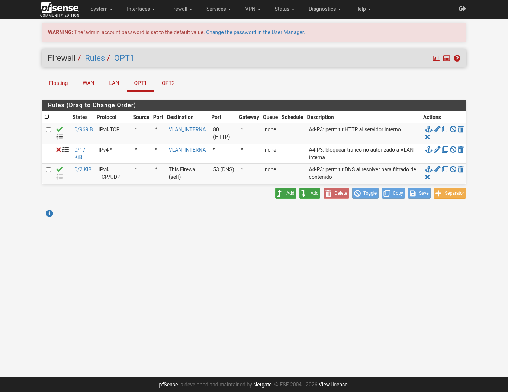
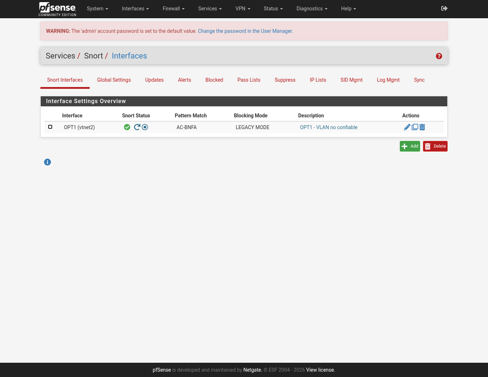
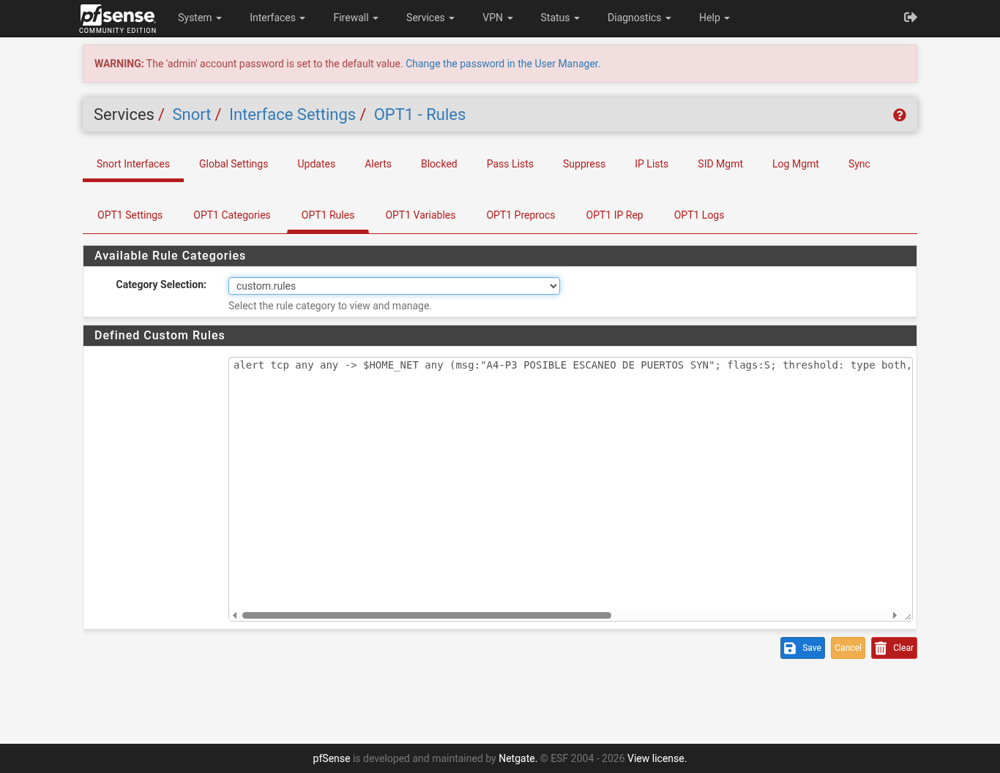
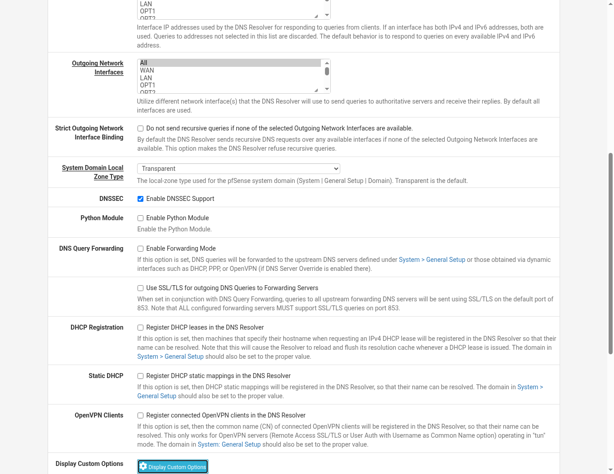
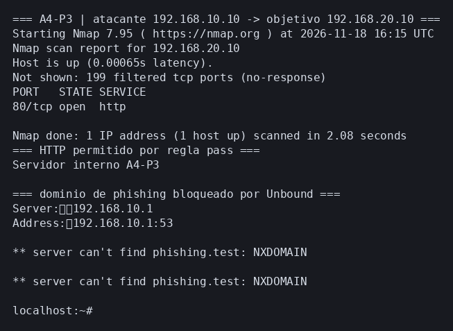
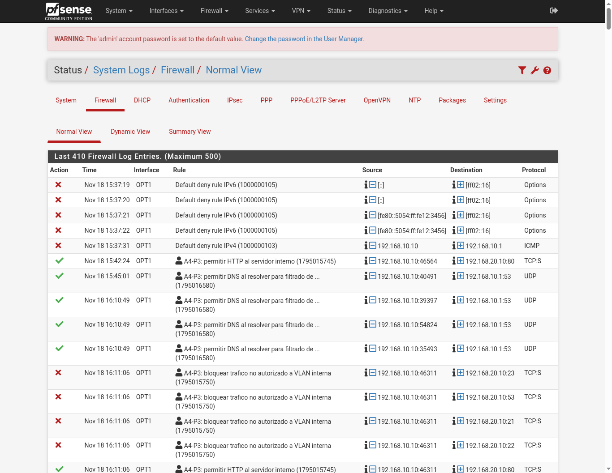
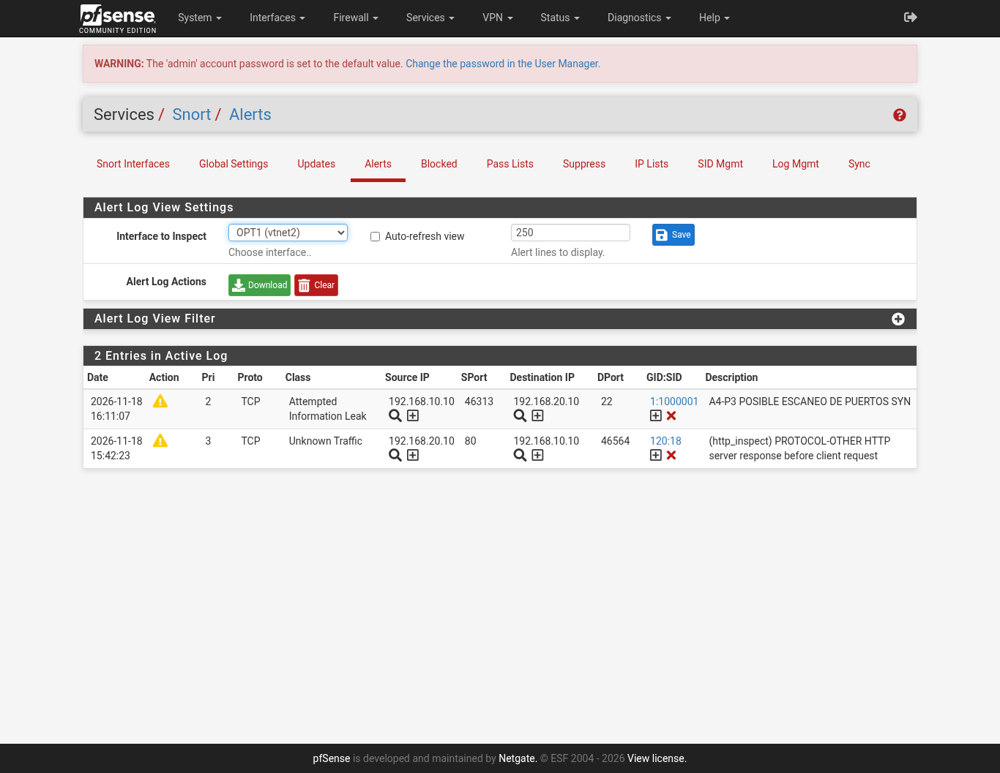

# Resumen

Esta actividad cubre cuatro frentes complementarios de la seguridad: el
análisis de vulnerabilidades web, el endurecimiento de una API, la defensa
perimetral y la priorización de riesgos. En la **parte 1** se desplegó DVWA
2.5 en un laboratorio local, se escaneó con OWASP ZAP 2.17 y se validaron
manualmente tres fallos del OWASP Top 10: inyección SQL, XSS reflejado y
control de acceso roto. En la **parte 2** se implementó una API HTTP en C11 —
con OpenSSL como única dependencia externa — que ofrece OAuth 2.0 (*client
credentials*), JWT HS256, validación estricta de entradas y *rate limiting* de
100 solicitudes por minuto; se verificó con 51 pruebas automatizadas. En la
**parte 3** se desplegó pfSense 2.7.2 con una VLAN no confiable y una VLAN
interna, se aplicaron reglas de firewall, una firma Snort personalizada contra
escaneos de puertos y un *sinkhole* DNS contra dominios de phishing, y se
validó todo con un ataque `nmap`. La **parte 4** integra los hallazgos en una
matriz de riesgos 5×5 y propone mitigaciones priorizadas.

# Introducción

La superficie de ataque de una aplicación moderna incluye el navegador, la
API que consume y el perímetro que los separa de la red interna. Los errores
de inyección y de autorización siguen ocupando los primeros lugares del OWASP
Top 10, las APIs necesitan mecanismos explícitos de autenticación,
autorización, validación y límites de uso, y un firewall mal segmentado
convierte cualquier fallo anterior en un incidente mayor. Este trabajo
aborda los cuatro frentes:

- **Parte 1:** identificar y explotar vulnerabilidades reales en una
  aplicación deliberadamente vulnerable (DVWA), usando una herramienta
  estándar de la industria (OWASP ZAP) y validación manual.
- **Parte 2:** construir un endpoint seguro en C, con la filosofía *suckless*
  (código pequeño, dependencias mínimas, configuración explícita), y
  demostrar con pruebas que resiste inyección, tokens manipulados y abuso de
  solicitudes.
- **Parte 3:** segmentar redes con pfSense, permitir solo el tráfico
  necesario, detectar reconocimiento con Snort y bloquear dominios de
  phishing mediante DNS.
- **Parte 4:** ordenar todas las amenazas encontradas con una matriz 5×5 de
  impacto y probabilidad, y proponer mitigaciones para cada una.

# Parte 1 — Análisis de vulnerabilidades en DVWA

## 1.1 Entorno y alcance

El alcance es la aplicación DVWA 2.5 en `http://127.0.0.1:8081`, con nivel de
seguridad `low`, que reproduce los fallos didácticos clásicos. Quedan fuera
del alcance el sistema operativo, la red y la base de datos como activos
independientes.

| Componente | Versión |
|---|---|
| DVWA | 2.5 |
| PHP | 8.5.12 (servidor embebido) |
| MariaDB | 11.4.13 |
| OWASP ZAP | 2.17.0 |
| Nix / nixpkgs | 2.35.1 / commit `d5cc683` |

El entorno se levanta con:

```sh
nix develop
./parte1/scripts/lab-up.sh
./parte1/scripts/run-zap.sh
./parte1/scripts/capture-evidence.sh
./parte1/scripts/lab-down.sh
```

`lab-up.sh` descarga DVWA 2.5, inicializa MariaDB en `.lab/mysql`, arranca
PHP en `127.0.0.1:8081`, crea la base `dvwa`, ejecuta `setup.php`, inicia
sesión con `admin`/`password`, fija `security=low` y comprueba el módulo
SQLi. La sesión queda en `.lab/dvwa-session.env`, que no se versiona.

> **Nota sobre el entorno:** el primer intento con Docker falló porque el
> kernel no permite cgroups anidados
> (`bpf_prog_query(BPF_CGROUP_DEVICE): function not implemented`). Se
> descartó Docker y se usó Nix, ejecutando todo como usuario normal.

## 1.2 Metodología

1. **Preparación:** DVWA + MariaDB + PHP, seguridad `low`.
2. **Autenticación de ZAP:** DVWA usa un token anti-CSRF en el login. Para no
   depender de la heurística del *form-based auth*, se inició sesión con un
   script y se inyectó la cookie en ZAP mediante `ZAP_AUTH_HEADER`,
   `ZAP_AUTH_HEADER_VALUE` y `ZAP_AUTH_HEADER_SITE`. El contexto usa
   autenticación `manual`.
3. **Descubrimiento:** un job `requestor` siembra en el historial los módulos
   que el *spider* no descubre por sí solo (endpoints AJAX como
   `get_user_data.php`); después se ejecutan *spider*, escaneo pasivo y
   escaneo activo.
4. **Validación manual:** cada hallazgo se reprodujo con `curl`, guardando
   petición, código de estado y respuesta en `parte1/evidence/`.
5. **Evaluación de riesgo:** se aplicó la plantilla de la sección 1.3.

Plan de ZAP: `parte1/zap/plan.yaml`. Informes:
`parte1/evidence/zap-report.html` y `parte1/evidence/zap-report.json`.

> El escaneo activo se ejecutó únicamente contra DVWA en localhost, una
> aplicación deliberadamente vulnerable y autorizada para este ejercicio.

## 1.3 Plantilla de evaluación de riesgos

| Campo | Descripción |
|---|---|
| **ID** | Identificador único del hallazgo |
| **Vulnerabilidad** | Nombre y descripción breve |
| **OWASP Top 10** | Categoría 2021 |
| **CWE** | Debilidad concreta |
| **Activo / endpoint** | Componente afectado |
| **Vector de ataque** | Petición o secuencia que lo explota |
| **Impacto potencial** | Confidencialidad, integridad, disponibilidad y negocio |
| **Probabilidad (1–5)** | Facilidad de explotación y exposición |
| **Impacto (1–5)** | Severidad si se explota |
| **Riesgo inherente** | Probabilidad × Impacto |
| **Nivel** | Bajo 1–4 · Medio 5–9 · Alto 10–14 · Crítico 15–25 |
| **Evidencia** | Archivo o petición reproducible |
| **Mitigación** | Controles recomendados |
| **Riesgo residual** | Riesgo esperado tras aplicar los controles |

## 1.4 Hallazgos

### A4-P1-01 — SQL Injection en `/vulnerabilities/sqli/`

| Campo | Valor |
|---|---|
| **ID** | A4-P1-01 |
| **Vulnerabilidad** | Inyección SQL clásica por concatenación de `id` en `SELECT first_name, last_name FROM users WHERE user_id = '$id'` |
| **OWASP Top 10** | A03:2021 — Injection |
| **CWE** | CWE-89 |
| **Activo / endpoint** | `GET /vulnerabilities/sqli/?id=...&Submit=Submit` |
| **Vector** | `id=1' UNION SELECT user, password FROM users -- -` |
| **Impacto potencial** | Lectura completa de la tabla `users`, incluidos hashes MD5 de contraseñas; con consultas de escritura, alteración o borrado. Confidencialidad **alta**, integridad **alta**, disponibilidad **media**. Permite cracking offline y reutilización de credenciales. |
| **Probabilidad** | 4 — requiere sesión, pero el laboratorio usa credenciales por defecto y el fallo se explota con una sola petición |
| **Impacto** | 5 — exposición de credenciales y datos de todos los usuarios |
| **Riesgo inherente** | **20 / Crítico** |
| **Evidencia** | `parte1/evidence/manual-sqli.txt` y `manual-sqli.html`; ZAP reporta *SQL Injection* sobre `id`. |
| **Mitigación** | Consultas preparadas, validación de `id` como entero positivo, usuario de BD con privilegios mínimos, ocultar errores SQL, WAF y SAST/DAST en CI. |
| **Riesgo residual** | Bajo (2–4) con consultas preparadas y mínimo privilegio |

Respuesta observada (resumida):

```text
First name: admin   | Surname: 903a98d709fa4683aaaa036b84c125a6
First name: gordonb | Surname: e99a18c428cb38d5f260853678922e03
First name: 1337    | Surname: 8d3533d75ae2c3966d7e0d4fcc69216b
First name: pablo   | Surname: 0d107d09f5bbe40cade3de5c71e9e9b7
First name: smithy  | Surname: 5f4dcc3b5aa765d61d8327deb882cf99
```

Los valores de `password` son hashes MD5 sin *salt*; el último corresponde a
`password`.

{width=95%}

### A4-P1-02 — XSS reflejado en `/vulnerabilities/xss_r/`

| Campo | Valor |
|---|---|
| **ID** | A4-P1-02 |
| **Vulnerabilidad** | `name` se concatena sin codificar dentro de `<pre>Hello ...</pre>` y la respuesta desactiva el filtro con `X-XSS-Protection: 0` |
| **OWASP Top 10** | A03:2021 — Injection |
| **CWE** | CWE-79 |
| **Activo / endpoint** | `GET /vulnerabilities/xss_r/?name=...` |
| **Vector** | `name=<script>alert(document.cookie)</script>`; también un `onerror` en `` |
| **Impacto potencial** | Robo de `PHPSESSID` (sin `HttpOnly`), del token CSRF y ejecución de acciones como la víctima; phishing y desfiguración. Confidencialidad **alta**, integridad **media**, disponibilidad **baja**. |
| **Probabilidad** | 4 — el enlace malicioso se envía a una víctima autenticada |
| **Impacto** | 4 — secuestro de sesión y acciones en nombre de la víctima |
| **Riesgo inherente** | **16 / Crítico** |
| **Evidencia** | `parte1/evidence/manual-xss.txt` y `manual-xss.html`; ZAP reporta *Cross Site Scripting (Reflected)*. |
| **Mitigación** | Codificación contextual de salida (`htmlspecialchars(..., ENT_QUOTES, 'UTF-8')`), CSP restrictiva, cookies `HttpOnly; Secure; SameSite=Lax`, validación por allowlist y evitar `innerHTML`/`document.write`. |
| **Riesgo residual** | Bajo (2–4) con codificación de salida y CSP |

Respuesta observada:

```html
<pre>Hello <script>alert(document.cookie)</script></pre>
```

{width=95%}

### A4-P1-03 — Broken Access Control / IDOR en `/vulnerabilities/authbypass/`

| Campo | Valor |
|---|---|
| **ID** | A4-P1-03 |
| **Vulnerabilidad** | `get_user_data.php` y `change_user_details.php` no exigen sesión ni rol: en `low`/`medium` solo comprueban el rol en `high`/`impossible`. La lectura devuelve todos los usuarios y la escritura actualiza cualquier `user_id` |
| **OWASP Top 10** | A01:2021 — Broken Access Control |
| **CWE** | CWE-306, CWE-862, CWE-639 |
| **Activo / endpoint** | `GET /vulnerabilities/authbypass/get_user_data.php` y `POST /vulnerabilities/authbypass/change_user_details.php` |
| **Vector** | Petición directa **sin cookie** a `get_user_data.php`; para escritura, `POST` JSON con `id`, `first_name` y `surname` de cualquier usuario |
| **Impacto potencial** | Enumeración de usuarios y datos personales; modificación no autorizada de perfiles; escalada de privilegios y toma de cuentas si se combina con otros módulos. Confidencialidad **alta**, integridad **alta**, disponibilidad **baja**. |
| **Probabilidad** | 5 — no requiere autenticación y el endpoint es accesible directamente |
| **Impacto** | 4 — datos de todos los usuarios y escritura arbitraria |
| **Riesgo inherente** | **20 / Crítico** |
| **Evidencia** | `parte1/evidence/manual-authbypass.txt` y `manual-authbypass.json` |
| **Mitigación** | Middleware central de autenticación y autorización para **todas** las rutas, denegar por defecto, comprobación a nivel de objeto, sesión de servidor y CSRF en escrituras, consultas preparadas, auditoría y pruebas de autorización en CI. |
| **Riesgo residual** | Bajo (2–4) con autorización centralizada y pruebas negativas |

Respuesta observada (sin sesión, `200 OK`):

```json
[{"user_id":"1","first_name":"admin","surname":"admin"},
 {"user_id":"2","first_name":"Gordon","surname":"Brown"},
 {"user_id":"3","first_name":"Hack","surname":"Me"},
 {"user_id":"4","first_name":"Pablo","surname":"Picasso"},
 {"user_id":"5","first_name":"Bob","surname":"Smith"}]
```

{width=95%}

`change_user_details.php` también concatena los valores en la consulta de
escritura:

```php
$query = "UPDATE users SET first_name = '" . $data->first_name .
         "', last_name = '" . $data->surname .
         "' where user_id = " . $data->id;
```

## 1.5 Hallazgos de ZAP

El informe de ZAP 2.17.0 confirma los tres fallos principales y añade
problemas de configuración: **SQL Injection** (40018, alto) sobre `id`,
**Cross Site Scripting (Reflected)** (40012, alto) y **DOM Based** (40026,
alto) sobre `name`, ausencia de tokens anti-CSRF (10202, 5 instancias),
divulgación de errores de aplicación (90022, 12), CSP ausente o incompleta
(10038/10055), falta de cabecera anti-clickjacking (10020), cookies sin
`HttpOnly`/`SameSite`, fuga de versión en `X-Powered-By` y ausencia de
`X-Content-Type-Options`. La alerta *Cloud Metadata Potentially Exposed*
(90034) es un falso positivo: el servidor de laboratorio redirige cualquier
ruta desconocida a `login.php`. ZAP no detecta el control de acceso roto
porque es un fallo de lógica, sin firma reconocible; por eso se validó
manualmente.

{width=100%}

## 1.6 Limitaciones de la parte 1

- DVWA es deliberadamente vulnerable; los resultados no se extrapolan
  directamente a un sistema productivo.
- El nivel `low` maximiza la exposición con fines didácticos. Los niveles
  `medium`, `high` e `impossible` reducen o eliminan varios fallos y pueden
  usarse como comparación.
- El escaneo se ejecutó contra `127.0.0.1`; no se probó ningún sistema de
  terceros.
- ZAP no detecta por sí solo todos los fallos de lógica; por eso
  `get_user_data.php` se validó manualmente.

# Parte 2 — API segura en C

## 2.1 Diseño y filosofía suckless

La API se implementó en un único archivo `parte2/api.c`, usando libc, POSIX y
una sola dependencia externa: `libcrypto` de OpenSSL para HMAC-SHA-256.
Mantener una implementación propia del hash había sido una opción, pero en
criptografía el código casero es una fuente de errores sutiles; delegar la
primitiva a una biblioteca auditada reduce el código y el riesgo, sin
introducir framework, ORM, SQL ni `system()`. "Dependencias mínimas" no
significa "cero dependencias". La configuración vive en `config.def.h`; los
secretos se leen del entorno. El binario se compila con:

```sh
cd parte2
nix develop .. -c make
A4_JWT_SECRET='...' A4_CLIENT_SECRET='...' ./api
```

| Variable | Valor por defecto | Uso |
|---|---|---|
| `A4_PORT` | `8080` | puerto en `127.0.0.1` |
| `A4_JWT_SECRET` | secreto de laboratorio | clave HS256 |
| `A4_CLIENT_SECRET` | secreto de laboratorio | secreto OAuth del cliente |
| `A4_RATE_LIMIT` | `100` | solicitudes por ventana y credencial/IP |
| `A4_RATE_WINDOW` | `60` | segundos de la ventana |

Los valores por defecto son de laboratorio; en producción se deben inyectar
secretos fuertes y poner el binario detrás de TLS.

## 2.2 Endpoints

| Método | Ruta | Autenticación | Descripción |
|---|---|---|---|
| `GET` | `/healthz` | — | sonda de vida |
| `POST` | `/oauth/token` | cliente OAuth | *client credentials*, devuelve JWT |
| `GET` | `/api/v1/profile` | JWT (`read`) | identidad y scopes |
| `POST` | `/api/v1/transfers` | JWT (`transfer`) | transferencia simulada y validada |

Ejemplo de obtención de token:

```sh
curl -s -X POST http://127.0.0.1:8080/oauth/token \
  -H 'Content-Type: application/x-www-form-urlencoded' \
  --data 'grant_type=client_credentials&client_id=demo-client&client_secret=...&scope=read transfer'
```

Respuesta:

```json
{"access_token":"eyJ...","token_type":"Bearer","expires_in":900,"scope":"read transfer"}
```

{width=100%}

## 2.3 OAuth 2.0 y JWT

- Grant `client_credentials` (RFC 6749 §4.4), con `client_id` y
  `client_secret` comparados en tiempo constante.
- Scopes permitidos: `read` y `transfer`; cualquier otro devuelve
  `invalid_scope`.
- JWT **HS256** exclusivamente: se rechaza `alg: none`, algoritmos distintos
  y tokens sin firma.
- Claims obligatorios: `iss`, `aud`, `sub`, `scope`, `iat`, `exp`, `jti`.
- Se valida la firma HMAC-SHA-256 en tiempo constante, el emisor, la
  audiencia, la expiración, `iat` no futuro y la vida máxima del token.
- `jti` se genera con 16 bytes de `/dev/urandom`; TTL de 900 s.

La implementación incluye SHA-256 y HMAC-SHA-256 propios para no enlazar
OpenSSL y mantener el binario pequeño.

## 2.4 Validación de entradas

La ruta de transferencias acepta únicamente:

```json
{"account":"ABC-1234","amount":250}
```

Reglas:

- `Content-Type: application/json` (se acepta un parámetro `charset`).
- Cuerpo máximo de 1024 bytes; `Content-Length` obligatorio y estricto.
- Parser JSON plano propio: solo objeto, strings ASCII imprimibles y enteros.
  Rechaza duplicados, campos desconocidos, controles, UTF-8 no ASCII,
  `null`, booleanos, floats, exponentes y ceros a la izquierda.
- `account`: exactamente `^[A-Z]{3}-[0-9]{4}$`.
- `amount`: entero entre 1 y 1 000 000.
- No hay SQL, `system()` ni rutas de archivo: la inyección no tiene
  superficie de ejecución y, aun así, se rechaza en la frontera.

La validación se probó con payloads de SQLi, XSS, *command injection* y
*path traversal*; todos devuelven `400` con un campo de error genérico, sin
reflejar la entrada.

## 2.5 Rate limiting

- 100 solicitudes por minuto y por credencial (`sub` del JWT).
- 100 solicitudes por minuto y por IP en `/oauth/token` y en `/api/*`
  (cubos separados).
- Ventana fija; al exceder se responde `429` con `Retry-After`.
- Tabla hash de 1024 entradas con sondeo lineal; si se llena, falla cerrado.

## 2.6 Pruebas y resultados

`parte2/tests/test_api.py` usa solo la biblioteca estándar de Python y cubre
51 casos: OAuth, JWT (firma/alg/exp/iss/aud/scope), SQLi, XSS, *command
injection*, *path traversal*, JSON malformado, tipos incorrectos, tamaños
máximos, *content-type*, 404, 100 req/min, `429` + `Retry-After` y reinicio
de ventana.

```sh
cd parte2
nix develop .. -c make test
```

Resultado final: **51/51 pruebas correctas**. Evidencia:
`parte2/evidence/test-results.txt`.

{width=90%}

También se incluye `parte2/postman_collection.json` para probar el flujo
desde Postman: primero se ejecuta **OAuth 2.0 → Token** (guarda
`accessToken`) y después las peticiones de **API**.

## 2.7 Decisiones de seguridad y límites

- Un solo hilo y una conexión por solicitud: suficiente para el laboratorio;
  un despliegue real debería usar `poll`/`epoll` o un pool.
- Sin TLS: debe ir detrás de un terminador TLS.
- Sin persistencia ni revocación de `jti`: el estado de *rate limiting* es en
  memoria y se reinicia con el proceso.
- Hardening de compilación: `-fstack-protector-strong`,
  `-D_FORTIFY_SOURCE=2`, PIE, `RELRO` completo y `-Werror`.
- Dependencia externa única: OpenSSL `libcrypto` para HMAC-SHA-256, en lugar
  de reimplementar la primitiva criptográfica.
- No se registran tokens, secretos ni cuerpos de solicitud.

# Parte 3 — Defensa perimetral con pfSense y Snort

## 3.1 Topología y entorno

Se virtualizó **pfSense CE 2.7.2** con KVM/QEMU, sin `sudo` ni `doas`, usando
el entorno `devShells.parte3` del *flake*. El firewall tiene cuatro NICs
virtio; la GUI se automatizó con Selenium/Chromium sobre
`https://127.0.0.1:8443`.

| Interfaz | Red | Papel |
|---|---|---|
| `vtnet0` / WAN | DHCP `10.0.2.15/24` | salida a Internet |
| `vtnet1` / LAN | `192.168.1.1/24` | administración (GUI) |
| `vtnet2` / OPT1 | `192.168.10.1/24` | VLAN no confiable, atacante `192.168.10.10` |
| `vtnet3` / OPT2 | `192.168.20.1/24` | VLAN interna, servidor `192.168.20.10` |

OPT1 y OPT2 se unen mediante *socket hubs* de QEMU (`127.0.0.1:10001` y
`:10002`). El atacante y el objetivo son dos máquinas Alpine 3.20 arrancadas
desde `alpine-virt.iso`; el atacante lleva una segunda NIC en la red
user-mode únicamente para instalar `nmap`, de modo que el escaneo sale
realmente por la VLAN no confiable. En pfSense se instalaron los paquetes
`pfSense-pkg-snort-4.1.6_17` y `pfSense-pkg-pfBlockerNG-devel-3.2.0_20` desde
el propio firewall. Para el filtrado de contenido se eligió la configuración
personalizada de Unbound: es determinista, no depende de *feeds* externos y
queda auditable en un solo archivo. pfBlockerNG queda disponible para
incorporar listas de inteligencia de amenazas en una siguiente iteración.

Toda la configuración, incluidos los arranques y la provisión de reglas, está
en `parte3/` y se reproduce con:

```sh
nix develop .#parte3 -c tmux new-session -s pfsense ./parte3/start-pfsense.sh
nix develop .#screenshots -c python3 parte3/setup-gui.py
```

## 3.2 Reglas de firewall

Se crearon los alias `VLAN_INTERNA` (`192.168.20.0/24`) y
`VLAN_NO_CONFIABLE` (`192.168.10.0/24`). En OPT1 se aplicaron tres reglas,
con registro activado:

1. **Pass** `TCP` de cualquier origen a `VLAN_INTERNA:80`: único servicio
   expuesto en la red interna.
2. **Pass** `TCP/UDP` a `This Firewall:53`: permite al segmento no confiable
   usar el resolver, necesario para el filtrado de contenido.
3. **Block** de cualquier protocolo a `VLAN_INTERNA`: niega el resto del
   tráfico, con bitácora.

Cualquier paquete que no coincide con esas reglas cae en la regla implícita
*default deny*. Las reglas se aplicaron desde la GUI y quedaron activas.

{width=95%}

## 3.3 Detección con Snort

Snort se habilitó sobre `opt1` con el perfil `AC-BNFA`, registro en el log
del sistema y en formato Unified2, y la opción *Block Offenders* activada.
Se añadió la firma personalizada que se distribuye en
`parte3/snort-custom.rules`:

```snort
alert tcp any any -> $HOME_NET any (msg:"A4-P3 POSIBLE ESCANEO DE PUERTOS SYN"; \
    flags:S; threshold: type both, track by_src, count 15, seconds 5; \
    sid:1000001; rev:1; classtype:attempted-recon;)
```

La regla dispara una alerta cuando un mismo origen envía 15 paquetes SYN en
5 segundos hacia la red interna. El umbral evita confundir una conexión
normal con reconocimiento, pero detecta un `nmap -sS` convencional.

{width=95%}

{width=95%}

La lista de exclusión (*pass list*) por defecto incluye las redes locales del
laboratorio, por lo que el atacante no llega a ser bloqueado por Snort: la
validación realizada es de **detección (IDS)**. El bloqueo de accesos a la
VLAN interna lo ejecuta PF con la regla 3. En un despliegue productivo se
debería usar una lista de exclusión explícita y modo IPS, además de
descargar los conjuntos de reglas oficiales.

## 3.4 Filtrado de contenido

El archivo `parte3/unbound-phishing.conf` se cargó en *Services › DNS
Resolver › Custom Options*:

```unbound
local-zone: "phishing.test" always_nxdomain
local-zone: "paypal-seguridad.test" always_nxdomain
local-zone: "banco-falso.test" always_nxdomain
local-zone: "login-microsoft.test" always_nxdomain
```

Para demostrar que el bloqueo es obra de la política y no un dominio inexistente,
antes se publicó `local-data: "phishing.test. 60 IN A 192.168.20.10"` y se
comprobó que el atacante obtenía esa dirección. Después de aplicar las zonas
`always_nxdomain`, la misma consulta devuelve `NXDOMAIN`. La evidencia
completa está en `parte3/evidence/filtrado-dns.txt`.

{width=95%}

## 3.5 Ataque y validación

Desde el atacante (`192.168.10.10`) se ejecutó:

```sh
nmap -Pn -sS -T4 -p 1-200 192.168.20.10
wget -qO- -T 4 http://192.168.20.10/
nslookup phishing.test 192.168.10.1
```

El escaneo tardó 2,08 s: el puerto 80 aparece `open` y los otros 199 como
`filtered`, exactamente lo que corresponde a la combinación *pass* + *block*.
El cuerpo HTTP devuelto fue `Servidor interno A4-P3` y el dominio de phishing
resolvió a `NXDOMAIN`.

{width=95%}

La bitácora del firewall muestra los SYN bloqueados contra puertos como 21,
22, 23 y 143 y el SYN permitido al 80; Snort registra la alerta
`1:1000001 A4-P3 POSIBLE ESCANEO DE PUERTOS SYN` con origen
`192.168.10.10:46313`.

{width=95%}

{width=95%}

| Comprobación | Resultado | Evidencia |
|---|---|---|
| Acceso HTTP a la VLAN interna | permitido | `07-pfsense-reglas.png`, `ataque.txt` |
| Resto de puertos hacia la VLAN interna | bloqueado y registrado | `08-pfsense-firewall-log.png` |
| Escaneo SYN detectado | alerta SID `1000001` | `11-pfsense-snort-alertas.png` |
| Dominio de phishing | `NXDOMAIN` | `12-pfsense-unbound.png`, `filtrado-dns.txt` |

## 3.6 Alcance y limitaciones

- El laboratorio usa reglas Snort propias, no los paquetes VRT/ET descargados;
  por eso la firma detecta el patrón del ataque, no cualquier variante.
- El filtrado actúa sobre DNS; no inspecciona el contenido HTTP ni TLS.
- Los dominios bloqueados son de prueba con TLD reservado `.test`; en producción
  se alimentaría la lista desde OpenPhish/PhishTank o pfBlockerNG.
- El atacante está en la lista de exclusión por defecto de Snort, así que no
  se validó el bloqueo activo del IDS, sino su capacidad de alertar.

# Parte 4 — Valoración de riesgos 5×5

## 4.1 Escalas

La probabilidad describe la facilidad de explotación dadas las condiciones
actuales del laboratorio; el impacto mide la consecuencia sobre
confidencialidad, integridad o disponibilidad.

| Valor | Probabilidad | Impacto |
|---|---|---|
| 1 | Rara: requiere acceso físico o condiciones muy improbables | Insignificante: sin efecto funcional |
| 2 | Improbable: explotación difícil o muy específica | Menor: molestia, sin pérdida de datos |
| 3 | Posible: existen herramientas públicas pero se necesita acceso | Moderado: pérdida limitada o degradación |
| 4 | Probable: explotación sencilla y accesible | Grave: exposición de datos o caída del servicio |
| 5 | Casi cierta: sin control y con atacante motivado | Crítico: compromiso total o daño regulatorio |

El riesgo es `I × P` y se clasifica en cinco bandas:

| Riesgo | 1–4 | 5–9 | 10–14 | 15–19 | 20–25 |
|---|---|---|---|---|---|
| Nivel | Bajo | Medio | Alto | Muy alto | Crítico |

## 4.2 Matriz

Cada celda muestra `riesgo · identificador(es)`. Las amenazas están numeradas
R1–R12 y se detallan en la siguiente sección.

| Impacto / Probabilidad | P1 | P2 | P3 | P4 | P5 |
|---|---|---|---|---|---|
| **I5** | 5 | 10 · R10 | 15 · R4 | 20 · R2, R5 | 25 · R1 |
| **I4** | 4 | 8 · R12 | 12 · R6, R7 | 16 · R3 | 20 |
| **I3** | 3 | 6 | 9 · R11 | 12 · R8 | 15 |
| **I2** | 2 | 4 | 6 | 8 | 10 · R9 |
| **I1** | 1 | 2 | 3 | 4 | 5 |

Los riesgos críticos son **R1 (inyección SQL en DVWA)**, **R2 (control de
acceso roto)** y **R5 (acceso no autorizado a la VLAN interna)**, todos con
valor 20–25. Les siguen R3 (XSS, 16) y R4 (JWT manipulado, 15) como muy altos.

## 4.3 Priorización y mitigaciones

| ID | Amenaza | Origen | I | P | Riesgo | Mitigación propuesta | Estado |
|---|---|---|---|---|---|---|---|
| R1 | Inyección SQL (`UNION` vuelca usuarios y hashes) | Parte 1 | 5 | 5 | 25 | Consultas parametrizadas, usuario DB con privilegios mínimos, WAF como defensa en profundidad y prueba de regresión por consulta | Pendiente en DVWA; controlado en la API |
| R2 | Control de acceso roto (`get_user_data.php` sin sesión) | Parte 1 | 5 | 4 | 20 | Autorización central por middleware, denegar por defecto, comprobar el objeto solicitado frente al sujeto autenticado | Pendiente en DVWA |
| R3 | XSS reflejado (robo de `PHPSESSID`) | Parte 1 | 4 | 4 | 16 | Escapado contextual, CSP sin `unsafe-inline`, cookies `HttpOnly`/`SameSite` | Pendiente en DVWA |
| R4 | JWT manipulado (`alg=none`, firma débil, `exp` ausente) | Parte 2 | 5 | 3 | 15 | Verificar firma, `alg` permitido, `exp`, `iss` y `aud`; secreto desde gestor y rotación; RS256 si hay varios servicios | Implementado; rotación pendiente |
| R5 | Acceso no autorizado a la VLAN interna | Parte 3 | 5 | 4 | 20 | Regla `default deny`, lista blanca de servicios, registro centralizado y revisión periódica de reglas | Implementado y validado |
| R6 | Phishing / suplantación por DNS | Parte 3 | 4 | 3 | 12 | *Sinkhole* DNS con listas actualizadas, DNSSEC, MFA y formación de usuarios | Implementado con zonas de prueba |
| R7 | API sin TLS | Parte 2 | 4 | 3 | 12 | Terminador TLS delante de la API, HSTS y certificados gestionados | Pendiente (fuera del laboratorio) |
| R8 | Abuso de API sin límite de tasa | Parte 2 | 3 | 4 | 12 | Mantener el limitador por cliente e IP; en producción usar *rate limiting* distribuido y API gateway | Implementado |
| R9 | Reconocimiento mediante escaneo de puertos | Parte 3 | 2 | 5 | 10 | Regla Snort `1000001`, reducir superficie expuesta, correlacionar alertas en SIEM | Detectado y registrado |
| R10 | Inyección SQL en la API | Parte 2 | 5 | 2 | 10 | Validación estricta y consultas parametrizadas si se añade persistencia; prueba automatizada ya incluida | Implementado |
| R11 | Falsos negativos del IDS por reglas desactualizadas | Parte 3 | 3 | 3 | 9 | Actualización automática de reglas VRT/ET, ajuste de umbrales y revisión de alertas | Pendiente |
| R12 | Exposición de secretos por configuración | Parte 2 | 4 | 2 | 8 | Secretos en variables de entorno o gestor, rotación, exclusión de archivos sensibles del repositorio | Parcial (entorno) |

## 4.4 Plan de remediación

- **P0 (crítico, 20–25):** R1, R2 y R5. Se atienden antes de cualquier
  despliegue: parametrizar consultas y autorizar en servidor en DVWA, y
  mantener la segmentación con reglas explícitas en el firewall.
- **P1 (muy alto, 15–19):** R3 y R4. Escapado/CSP y verificación estricta del
  JWT; rotación de secretos.
- **P2 (alto, 10–14):** R6, R7, R8, R9 y R10. Ampliar el filtrado DNS a listas
  externas, añadir TLS, reforzar el limitador y mantener la firma Snort.
- **P3 (medio/bajo, <10):** R11 y R12. Automatizar la actualización de reglas
  y centralizar la gestión de secretos.

Tras aplicar las mitigaciones, el riesgo residual queda dominado por R1, R2 y
R7: los dos primeros exigen cambios de código en DVWA y el tercero depende de
la infraestructura TLS, que queda fuera del alcance de este laboratorio. La
matriz debe revisarse cuando cambie el inventario o se incorporen nuevas
fuentes de inteligencia de amenazas.

# Conclusiones

La parte 1 confirma que los fallos clásicos siguen siendo explotables con
herramientas estándar: una sola petición permitió extraer todos los usuarios
y sus hashes, un enlace reflejó JavaScript arbitrario y un endpoint AJAX
expuso datos sin sesión. La lección principal es que la validación de
entradas y la autorización deben aplicarse en el servidor, de forma
centralizada, y no confiar en controles del cliente.

La parte 2 demuestra que es posible construir una API pequeña y auditable en
C sin renunciar a controles esenciales: OAuth 2.0, JWT firmados, validación
estricta, autorización por scopes y *rate limiting*. Delegar el HMAC a OpenSSL
ilustra que "dependencias mínimas" no significa reimplementar criptografía.
Las 51 pruebas automatizadas convierten esas propiedades en algo verificable.

La parte 3 confirma que la segmentación bien configurada reduce la superficie
de ataque: de 200 puertos explorados solo el HTTP autorizado respondió, el
escaneo generó una alerta Snort con SID propio y el filtrado DNS devolvió
`NXDOMAIN` para los dominios de phishing. Finalmente, la parte 4 ordena los
hallazgos y muestra que los riesgos críticos no son los más visibles, sino
los que combinan impacto alto con explotación trivial: inyección SQL, control
de acceso roto y exposición de la red interna. El trabajo completo ofrece una
cadena de defensa reproducible, desde el código hasta el perímetro, con
evidencia para cada control aplicado.

# Referencias

- OWASP. *OWASP Top 10:2021*. <https://owasp.org/Top10/>
- OWASP. *Cross Site Scripting Prevention Cheat Sheet*.
- OWASP. *SQL Injection Prevention Cheat Sheet*.
- OWASP. *Authorization Cheat Sheet*.
- IETF. *RFC 6749 — The OAuth 2.0 Authorization Framework*.
- IETF. *RFC 7519 — JSON Web Token (JWT)*.
- OpenSSL. *EVP_Q_mac(3) — cálculo de MAC con EVP*.
  <https://docs.openssl.org/master/man3/EVP_Q_mac/>
- Netgate. *pfSense Documentation — Snort package*.
  <https://docs.netgate.com/pfsense/en/latest/packages/snort/>
- Cisco Talos. *Snort 2.9 User Manual*. <https://docs.snort.org/>
- NLnet Labs. *Unbound.conf — local-zone*.
  <https://unbound.docs.nlnetlabs.nl/en/latest/manpages/unbound.conf.html>
- NIST. *SP 800-30 Rev. 1 — Guide for Conducting Risk Assessments*.
- *suckless.org — software that sucks less*.
- OWASP ZAP. *Automation Framework*. <https://www.zaproxy.org/docs/>

# Anexos

## A. Comandos de reproducción

```sh
# Laboratorio completo
nix develop
./parte1/scripts/lab-up.sh
./parte1/scripts/run-zap.sh
./parte1/scripts/capture-evidence.sh

# API y pruebas
cd parte2
nix develop .. -c make test

# Laboratorio de perímetro (cuatro terminales)
cd ..
nix develop .#parte3 -c tmux new-session -s pfsense ./parte3/start-pfsense.sh
nix develop .#parte3 -c tmux new-session -s attacker ./parte3/start-attacker.sh
nix develop .#parte3 -c tmux new-session -s target ./parte3/start-target.sh
nix develop .#screenshots -c python3 parte3/setup-gui.py

# Capturas del informe (con los laboratorios levantados)
nix develop .#screenshots -c python3 scripts/capture-screenshots.py
nix develop .#screenshots -c python3 parte3/capture-screenshots.py
python3 scripts/render-terminal.py parte3/evidence/ataque.txt \
    docs/screenshots/13-ataque-nmap.png

# Compilar el informe
make
```

## B. Archivos de evidencia

| Archivo | Contenido |
|---|---|
| `parte1/evidence/zap-report.html` | Informe HTML de ZAP |
| `parte1/evidence/zap-report.json` | Informe JSON de ZAP |
| `parte1/evidence/manual-sqli.txt` | Evidencia de SQLi |
| `parte1/evidence/manual-xss.txt` | Evidencia de XSS |
| `parte1/evidence/manual-authbypass.txt` | Evidencia de control de acceso roto |
| `parte2/evidence/test-results.txt` | Resultado de las 51 pruebas |
| `parte3/evidence/ataque.txt` | Salida de nmap, HTTP y DNS desde el atacante |
| `parte3/evidence/firewall-log.txt` | Entradas del firewall durante el escaneo |
| `parte3/evidence/snort-alerta.txt` | Alerta generada por la firma `1000001` |
| `parte3/evidence/filtrado-dns.txt` | Resolución antes y después del bloqueo DNS |
| `parte3/snort-custom.rules` | Regla Snort personalizada |
| `parte3/unbound-phishing.conf` | Zonas DNS de phishing |
| `parte3/setup-gui.py` | Provisión reproducible de la GUI de pfSense |
| `docs/screenshots/01-sqli.png` | Captura de la inyección SQL |
| `docs/screenshots/02-xss.png` | Captura del XSS reflejado |
| `docs/screenshots/03-authbypass.png` | Captura del control de acceso roto |
| `docs/screenshots/04-zap.png` | Resumen del informe de ZAP |
| `docs/screenshots/05-flujo-api.png` | Flujo OAuth 2.0/JWT/validación |
| `docs/screenshots/06-pruebas-api.png` | Salida de las pruebas de la API |
| `docs/screenshots/07-pfsense-reglas.png` | Reglas de OPT1 |
| `docs/screenshots/08-pfsense-firewall-log.png` | Bitácora del firewall durante el ataque |
| `docs/screenshots/09-pfsense-snort-interfaces.png` | Snort activo en OPT1 |
| `docs/screenshots/10-pfsense-snort-regla.png` | Regla personalizada de Snort |
| `docs/screenshots/11-pfsense-snort-alertas.png` | Alerta del escaneo nmap |
| `docs/screenshots/12-pfsense-unbound.png` | Opciones de filtrado DNS |
| `docs/screenshots/13-ataque-nmap.png` | Consola del atacante |
| `scripts/capture-screenshots.py` | Generador reproducible de las capturas |
| `scripts/render-terminal.py` | Renderizado de la transcripción del atacante |
| `docs/bitacora.md` | Procedimiento cronológico y decisiones |
